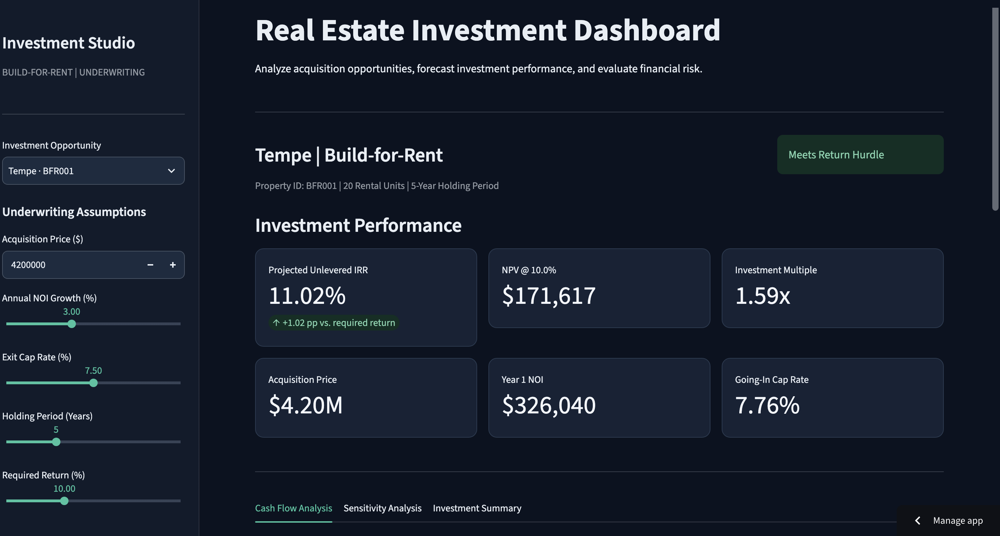

# Real Estate Acquisition & IRR Analytics Platform

### Interactive Real Estate Investment Underwriting Dashboard

An end-to-end financial analytics platform that integrates
Python, SQL, financial modeling, and interactive visualization
to evaluate Build-for-Rent (BFR) acquisition opportunities.

**Tech Stack:** Python · SQL · Pandas · SQLite · NumPy Financial · Plotly · Streamlit

**[Launch Live Dashboard](https://real-estate-irr-analytics.streamlit.app/)** | **[View Source Code](https://github.com/lucialin024/real-estate-acquisition-analytics)**

---

## Dashboard Preview



Explore the interactive dashboard to select investment properties,
adjust underwriting assumptions, and analyze projected returns.

---

## Project Overview

This project simulates real estate investment underwriting using
synthetic property-level data from five hypothetical Build-for-Rent
acquisition opportunities across Arizona.

The platform combines financial analysis, SQL-based acquisition
screening, multi-year cash flow forecasting, and investment
sensitivity analysis to support data-driven decision-making.

### Business Questions

- Which acquisition opportunities meet predefined investment criteria?
- How do property acquisition prices compare with operating income?
- What are the projected IRR, NPV, and investment multiples?
- How do NOI growth and exit cap rate assumptions affect returns?
- Which investment scenarios meet the required rate of return?

---

## Key Features

### 1. Acquisition Screening & Ranking

- Calculate acquisition price per rental unit
- Evaluate gross rental yield and going-in cap rates
- Screen investments by acquisition price, vacancy rate, and cap rate
- Rank qualified acquisitions by financial performance
- Generate investment portfolio summaries

### 2. Real Estate Financial Underwriting

- Calculate gross and effective rental income
- Estimate annual Net Operating Income (NOI)
- Forecast multi-year property operating cash flows
- Estimate terminal property value and net sale proceeds
- Calculate unlevered IRR, NPV, and investment multiples

### 3. Investment Sensitivity Analysis

- Evaluate different annual NOI growth assumptions
- Analyze changes in exit capitalization rates
- Generate a two-variable IRR sensitivity matrix
- Compare investment returns across market scenarios
- Evaluate results against a required return threshold

### 4. Interactive Streamlit Dashboard

- Select among five hypothetical Arizona BFR properties
- Adjust acquisition price and underwriting assumptions
- View financial KPIs and interactive Plotly charts
- Explore cash flow projections and sensitivity heatmaps
- Download investment cash flow schedules as CSV files

### 5. SQL Financial Analytics

- Create a SQLite database from property-level data
- Perform property screening and aggregation queries
- Use Common Table Expressions (CTEs) for financial calculations
- Calculate NOI and capitalization rates directly in SQL
- Generate acquisition and portfolio-level summaries

---

## Financial Methodology

### Property Operating Performance

**Annual Gross Rental Income**

    Monthly Rent × Number of Units × 12

**Effective Rental Income**

    Annual Gross Rent × (1 - Vacancy Rate)

**Net Operating Income (NOI)**

    Effective Rental Income × (1 - Operating Expense Ratio)

**Going-In Capitalization Rate**

    Annual NOI / Acquisition Price

### Investment Valuation

**Terminal Property Value**

    Forward NOI / Exit Capitalization Rate

**Net Sale Proceeds**

    Terminal Property Value × (1 - Selling Cost Rate)

**Internal Rate of Return (IRR)**

The annualized discount rate at which the net present value
of the projected investment cash flows equals zero.

**Net Present Value (NPV)**

The present value of projected investment cash flows
discounted at the selected required rate of return.

**Investment Multiple**

    Total Positive Cash Flows / Initial Investment

The current model calculates simplified unlevered investment
returns using annual NOI as a proxy for operating cash flow.

---

## Investment Screening Example

The initial acquisition screening model evaluates properties
using the following hypothetical criteria:

| Investment Criteria | Requirement |
|--------------------|-------------|
| Minimum Cap Rate | 8.0% |
| Maximum Acquisition Price | $7,000,000 |
| Maximum Vacancy Rate | 6.0% |

### Screening Results

| Property | Acquisition Price | Annual NOI | Cap Rate |
|----------|------------------:|-----------:|---------:|
| Chandler | $6,500,000 | $530,841.60 | 8.17% |
| Phoenix | $6,800,000 | $555,483.60 | 8.17% |

**Key Finding:** Two of the five hypothetical properties
satisfy the screening criteria, representing a combined
acquisition value of $13.3 million.

Cap rates alone do not determine whether an investment
should proceed. Multi-year returns, risk assumptions,
and additional due diligence must also be considered.

---

## Project Structure

```text
real-estate-acquisition-analytics/
|
|-- .streamlit/
|   |-- config.toml
|
|-- assets/
|   |-- dashboard_overview.png
|
|-- dashboard/
|   |-- app.py
|
|-- data/
|   |-- properties.csv
|   |-- qualified_acquisitions.csv
|   |-- tempe_cash_flow_forecast.csv
|   |-- exit_cap_sensitivity.csv
|   |-- two_variable_sensitivity.csv
|
|-- sql/
|   |-- 01_property_analysis.sql
|
|-- src/
|   |-- 01_explore_properties.py
|   |-- 02_create_database.py
|   |-- 03_run_sql.py
|   |-- 04_cash_flow_forecast.py
|   |-- 05_sensitivity_analysis.py
|   |-- 06_two_variable_sensitivity.py
|   |-- 07_test_financial_model.py
|   |-- financial_model.py
|
|-- .gitignore
|-- README.md
|-- requirements.txt
```

---

## Run Locally

### 1. Clone the Repository

```bash
git clone https://github.com/lucialin024/real-estate-acquisition-analytics.git
cd real-estate-acquisition-analytics
```

### 2. Create a Virtual Environment

```bash
python3 -m venv .venv
source .venv/bin/activate
```

### 3. Install Dependencies

```bash
python -m pip install -r requirements.txt
```

### 4. Launch the Dashboard

```bash
python -m streamlit run dashboard/app.py
```

Open the local URL displayed in the terminal.

---

## Technologies & Skills Demonstrated

| Category | Technologies / Skills |
|----------|----------------------|
| Programming | Python, SQL |
| Data Analysis | Pandas, data cleaning, aggregation |
| Database | SQLite, CTEs, SQL financial calculations |
| Financial Modeling | NOI, cap rate, IRR, NPV, investment multiples |
| Risk Analysis | Scenario analysis, exit cap sensitivity |
| Visualization | Streamlit, Plotly, interactive heatmaps |
| Development | Git, GitHub, reusable Python functions |

---

## Model Assumptions & Limitations

This project uses synthetic Arizona real estate data
created for educational and portfolio demonstration purposes.

The current underwriting model:

- Assumes simplified annual NOI growth
- Uses forward NOI to estimate terminal property value
- Incorporates selling costs at exit
- Calculates unlevered investment returns
- Does not model debt financing or investor-level leverage
- Excludes capital expenditures, acquisition closing costs,
  income taxes, and other property-specific adjustments

The results are illustrative and should not be interpreted
as investment recommendations.

No confidential employer data is included.

---

## Live Application

**[Open the Real Estate Acquisition & IRR Analytics Dashboard](https://real-estate-irr-analytics.streamlit.app/)**

---

## Author

**Lucia Lin**

Financial Analytics | Python | SQL | Investment Modeling

[GitHub](https://github.com/lucialin024)